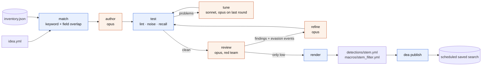

<h1 align="center">detection-engineering-agent</h1>
<p align="center">Detection idea YAML in. Tuned, red-teamed, contentctl-shaped Splunk detection out.</p>

<p align="center">
  <a href="https://github.com/javaisbetterthanpython/detection-engineering-agent/actions/workflows/ci.yml"></a>
  
  <a href="LICENSE"></a>
</p>

<p align="center">
  <picture>
    <source media="(prefers-color-scheme: dark)" srcset="docs/assets/run-dark.gif">
    <source media="(prefers-color-scheme: light)" srcset="docs/assets/run-light.gif">
    
  </picture>
  <br><sub>Recorded against Splunk Enterprise 10.6.1.1 on a DigitalOcean droplet ($0.0357 per hour, on Splunk's 60-day Enterprise trial license) with real inference (<code>claude-opus-4-8</code> for author, review and refine, <code>claude-sonnet-5-5</code> for tune); idle time collapsed. Run cost $0.60, 3 minutes 56 seconds. <a href="docs/splunk-test-server.md#record-of-real-runs">Reproduce it</a> with <code>scripts/splunk-droplet.sh</code>.</sub>
</p>

`dea` takes a detection idea, matches it to the sourcetypes your Splunk actually has, has a model write the SPL, and then puts every draft through code: lint, a schedule-shaped noise measurement, a recall check against ingested attack events. Noisy drafts are tuned; clean drafts are red-teamed by a second call that must prove each evasion with a concrete event the next draft has to catch. No model ever picks the next step. The output is detection-as-code YAML plus a filter macro, and `dea publish` installs it as a scheduled saved search.

## What you get

**In**: `tests/fixtures/idea.yml`

```yaml
id: 3f0e6b5a-1d0c-4c6e-9d3e-5b2d6a8c1f11
title: Office app spawns encoded PowerShell
source_url: https://thedfirreport.com/2026/10/30/example/
summary: >-
  A malicious Word macro launches powershell.exe with -EncodedCommand to fetch a second stage.
attack_steps:
  - "winword.exe or excel.exe or outlook.exe spawns powershell.exe"
  - "powershell.exe command line contains -enc or -EncodedCommand followed by base64"
indicators: ["-EncodedCommand", "-enc ", "powershell.exe"]
mitre_attack_id: [T1059.001, T1566.001]
type: TTP
severity: high
log_sources:
  - product: Windows Sysmon
    keywords: [sysmon]
    fields: [EventCode, Image, ParentImage, CommandLine]
  - product: Windows Security
    keywords: [wineventlog, security, "4688"]
    fields: [EventCode, New_Process_Name, Creator_Process_Name, Process_Command_Line]
sourcetypes: []
max_hits_per_day: null
false_positive_notes: Admin scripts launched from Office automation in finance.
attack_examples: []
attack_data_url: null
```

**Out**: the `search:` of [detections/office_app_spawns_encoded_powershell.yml](detections/office_app_spawns_encoded_powershell.yml), run 5's rendering; a frozen copy with its idea, state file and dry run is in [docs/examples/](docs/examples/office_app_spawns_encoded_powershell/).

```spl
index=wineventlog sourcetype="XmlWinEventLog:Microsoft-Windows-Sysmon/Operational" EventCode=1 (ParentImage="*WINWORD.EXE" OR ParentImage="*EXCEL.EXE" OR ParentImage="*OUTLOOK.EXE") | where match(ParentImage,"(?i)\\\\(winword|excel|outlook)\\.exe$") AND match(CommandLine,"(?i)\\s[-/]e[a-z]*[:\\s]+[\"']?[A-Za-z0-9+/=]{20,}") | stats count min(_time) as firstTime max(_time) as lastTime values(CommandLine) as CommandLine by Computer, User, ParentImage, Image | `office_app_spawns_encoded_powershell_filter`
```

Five drafts, three review rounds, six evasion events ingested for the recall gate, 0.14 alerts per day on the final draft, $1.30, 9 minutes 6 seconds. The hit counts are scripted fixtures; the SPL, findings and evasion events are model output. The whole run is in [docs/example-walkthrough.md](docs/example-walkthrough.md).

## Quick start

Needs [uv](https://docs.astral.sh/uv/) and [Claude Code](https://docs.claude.com/en/docs/claude-code) 2.1.280 or newer (`claude --version`; `claude update`), logged in: every model call is a local `claude -p` subprocess, so inference is billed to whatever account that CLI is signed into, and every dollar figure in this README is the CLI's own `total_cost_usd` (the CLI's estimate at API list prices: what an API-billed account pays; a Pro/Max subscription is not charged per run and instead spends plan usage). Mock Splunk replays `tests/fixtures/splunk` and does not evaluate SPL (including recall); only the inference is real.

```sh
uv sync                                                   # Python 3.13; uv fetches it
uv run dea inventory --splunk mock                        # instant, no inference
uv run dea publish detections/ --dry-run                  # instant: prints the saved-search stanza
uv run dea run tests/fixtures/idea.yml --splunk mock -v   # ~9 min, ~$1.30 (run 5, see note below)
uv run dea ideas tests/fixtures/article.html -o ideas/    # one haiku call: article -> idea YAMLs
```

- Python 3.13 only (`splunk-sdk==3.0.1` requires it). Every recorded run (runs 1-5, the droplet runs, the GIFs) passed `--model author=claude-opus-4-8 --model review=claude-opus-4-8 --model refine=claude-opus-4-8` because the recording machine had Claude Code 2.1.198, which rejects the default `claude-opus-5-5` (needs 2.1.280 or newer). The default's cost and path are therefore unmeasured; on an older CLI pass those overrides to reproduce the numbers here. `claude-sonnet-5-5` and `claude-haiku-5-5` work on 2.1.198.
- Nothing is printed to stdout until the final line; `--verbose` (`-v`) prints one stderr line per state transition (`matched -> drafted   author  $0.04  0:12`), which is what the GIFs show, or watch `cat runs/3f0e6b5a-1d0c-4c6e-9d3e-5b2d6a8c1f11/state.json` (the `history` list and `state`).
- `dea ideas` accepts a URL or a local `.html`, `.pdf`, `.txt` or `.md`; one haiku call per article. Known limit: articles rarely quote raw events, so `attack_examples` is usually empty and the detection renders as `experimental`.
- `dea run` writes `runs/<id>/` (git-ignored) and `detections/<stem>.yml` plus its macro, overwriting the committed run 5 rendering (`version` bumps when the SPL changed). Pass `-o detections_try` to keep the committed file; CI publishes whatever is in `detections/` on `main`.

<picture>
  <source media="(prefers-color-scheme: dark)" srcset="docs/assets/ideas-dark.gif">
  <source media="(prefers-color-scheme: light)" srcset="docs/assets/ideas-light.gif">
  
</picture>

<picture>
  <source media="(prefers-color-scheme: dark)" srcset="docs/assets/publish-dark.gif">
  <source media="(prefers-color-scheme: light)" srcset="docs/assets/publish-light.gif">
  
</picture>

## How a draft becomes a detection



Blue is deterministic code; orange is one `claude -p` call with a fixed payload and a JSON schema. Happy path: 2 calls (author, review). Hard maximum: 13.

| code | inference |
|---|---|
| `match`: keyword and field overlap against the inventory, top 4 sourcetypes | `author`: first SPL from the idea and the matched sources; again with `failed_attempts` after a remake |
| `test`: lint, 20-minute-bucketed noise run, recall over ingested events, rate against threshold | `tune`: fix the `problems` list the gate produced |
| routing: every guard reads gate results or finding severities, never a model verdict | `review`: red team the clean SPL; every evasion comes with an event that is ingested and must be caught |
| `render`, `publish`: YAML and REST properties templated from the idea and the SPL | `refine`: address the findings and match every evasion event |

The state machine itself, with its guards and budgets, is in [docs/pipeline.md](docs/pipeline.md).

## Gates: what `test` measures

The noise gate measures what the production schedule would alert on, not raw hits: the search is rewritten with `| bin _time span=20m` and `_time` in its `by` list, run over `--window` (default `-7d`), and each result row is one alert.

```
rate_per_day = count * 86400 / window_seconds
threshold    = idea.max_hits_per_day or {TTP: 5, Anomaly: 20, Hunting: 100}[idea.type]
noisy        = rate_per_day > threshold
ok           = no lint errors and no Splunk errors and recall ok and not noisy
```

The recall gate runs the un-bucketed search over the attack index, once per ingested event (the idea's `attack_examples`, then every evasion event a review produced), scoped by `host="dea-<run_id>-<n>"`; every one must hit. Lint rejects time modifiers, banned commands, `index=*`, unknown indexes, sourcetypes, macros and fields, bare leading wildcards and searches without group fields. Every authoring call also receives the nine rules in `prompts.RULES` verbatim; they are listed in [docs/inference.md](docs/inference.md#rules-sent-to-every-authoring-call).

Run 5, draft by draft (TTP threshold 5 per day; counts are the mock's scripted `runs.json` entries in call order):

| draft | origin | gate | what changed |
|--:|---|---|---|
| 1 | author (opus) | 412 alerts in -7d = 58.9/day > 5 | `Image` pinned to powershell.exe; `-enc(odedcommand)?` plus a 10-character base64 floor |
| 2 | tune (sonnet) | 60 → 8.6/day > 5 | `match()` everywhere; `-e(nc\|ncodedcommand)?` |
| 3 | tune (sonnet) | 2 → 0.29/day, clean | `-(e\|enc\|ec\|encodedcommand)`, 20-character floor, excludes `-(file\|f) ... .ps1` |
| 4 | refine (opus) | 1 → 0.14/day, clean | review 1: drops the attacker-satisfiable `-file` exclusion and the `Image` pin (renamed copies), ParentImage pre-filter, prefix match `-e[a-z]*` with `[:\s]+` separator |
| 5 | refine (opus) | 1 → 0.14/day, clean; recall 6/6 | review 2: `[-/]` prefix, optional quote before the base64 |

Draft 5 is the `search:` under [What you get](#what-you-get); every draft is verbatim from `state.json` in the [walkthrough](docs/example-walkthrough.md#drafts). Details of the gates: [docs/gates.md](docs/gates.md).

## Review

Round 1 of run 5, on draft 3. Severities and categories as the reviewer returned them; `detail` cut at the first sentence, full text in the [walkthrough](docs/example-walkthrough.md#round-1-draft-3).

| severity | category | finding |
|---|---|---|
| high | evasion | The switch regex `-(e\|enc\|ec\|encodedcommand)` only enumerates four spellings, but PowerShell accepts any unambiguous prefix of -EncodedCommand. [...] |
| high | evasion | The exclusion `AND NOT match(CommandLine, '(?i)\s-(file\|f)\s+\S+\.ps1')` is attacker-controllable. [...] |
| medium | evasion | The regex requires whitespace after the switch (`\s+[A-Za-z0-9+/=]`). PowerShell also accepts colon-delimited parameter syntax, e.g. `-enc:<base64>` or `-e:<base64>`, which contains no space before the value and therefore never matches. |
| medium | evasion | Detection keys only on Image ending in \powershell.exe. Sysmon EventID 1 also carries OriginalFileName, which remains PowerShell.EXE when the binary is copied/renamed (e.g. office macro drops %TEMP%\svc.exe = copy of powershell.exe and spawns it with -enc). [...] |
| low | performance | The base search retrieves every Sysmon EventCode=1 event and applies four regex via `where match()` with no index-time string pre-filter. [...] |
| low | logic | ParentImage is limited to winword\|excel\|outlook, which matches attack_steps. [...] |

Each evasion finding came with an evasion event, a real Sysmon sample edited into the variant the search misses (round 1's four are in the [walkthrough](docs/example-walkthrough.md#round-1-draft-3)). They were ingested into `dea_attack` under `dea-c5c9d0ae-<n>` and draft 4 had to match every one to pass recall; six were ingested over two rounds (scripted on the mock). Round 3 left one medium (a 12-character encoded `calc` stays under the 20-character base64 floor); with the review budget spent and nothing high or critical left, `residual_acceptable` approved the draft as `experimental`. The medium is in the record, not fixed.

Routing after a review is code over the findings list: only-low passes; otherwise refine while rounds remain and the `(category, severity)` set changed; otherwise approve as experimental unless a high or critical remains, which ends the run in `failed_review` (exit 4). The review prompt binds severity to the idea's `attack_steps`: variants of the described attack keep full severity and get an event; other attacks are at most low with no event.

<sub>The idea, SPL, drafts, findings and events above: run 5 · 2026-11-05 · mock Splunk fixtures · real Claude inference · $1.30 ([state file](docs/development/runs/e2e_run5_state.json)).</sub>

## Reference

<details>
<summary><b>Switching to a real Splunk</b></summary>

| variable | default | purpose |
|---|---|---|
| `SPLUNK_HOST` | required | management host |
| `SPLUNK_PORT` | `8089` | management port |
| `SPLUNK_TOKEN` | required | bearer token, sent as `Authorization: Bearer <token>`; its presence selects `real` |
| `SPLUNK_APP` | `search` | app context for saved searches and macros |
| `SPLUNK_OWNER` | `nobody` | namespace owner |
| `SPLUNK_VERIFY` | `1` | `0` disables TLS certificate verification (test servers only) |
| `DEA_SPLUNK` | automatic | `mock` or `real`; an explicit `--splunk` wins |
| `DEA_FIXTURES` | `tests/fixtures/splunk` | mock fixture directory |

```sh
export SPLUNK_HOST=splunk.example.org
export SPLUNK_TOKEN='...'
uv run dea inventory --splunk real --refresh
uv run dea run tests/fixtures/idea.yml --splunk real --window=-7d --verbose
uv run dea publish detections/ --splunk real --dry-run
```

The token needs search over your indexes, read/create and event submit on `--attack-index` (default `dea_attack`), and, for `dea publish`, macro and saved-search writes in `SPLUNK_APP`. The inventory (indexes, sourcetypes, common fields with top values, one raw sample per sourcetype, macro names) is cached in `inventory.json` for 24 hours; `--refresh` refetches. A throwaway server to try this on: [docs/splunk-test-server.md](docs/splunk-test-server.md). Adapter details: [docs/splunk.md](docs/splunk.md).

Validated against Splunk Enterprise 10.6.1.1 on a DigitalOcean `s-2vcpu-4gb` droplet ($0.0357 per hour, Splunk's 60-day trial license; `scripts/splunk-droplet.sh up` accepts the license for you). Three runs ended `done` ($0.60 to $1.03, recall 3/3 to 4/4) and `dea publish` produced a saved search that Splunk's scheduler ran with `status=success`. The script, the firewall-to-your-IP rule, the full record and the reproduce sequence: [docs/splunk-test-server.md](docs/splunk-test-server.md#record-of-real-runs).

</details>

<details>
<summary><b>Models and cost</b></summary>

| step | default model | effort | when |
|---|---|---|---|
| `ideas` | `claude-haiku-5-5` | medium | `dea ideas`, once per article |
| `author` | `claude-opus-5-5` | high | first draft; again after a remake |
| `tune` | `claude-sonnet-5-5`; the author model at effort high on the last allowed round | medium | after a failed gate |
| `review` | `claude-opus-5-5` | high | after a clean gate |
| `refine` | `claude-opus-5-5` | high | after findings above low |

`--model STEP=MODEL` (repeatable) overrides a pipeline step; `dea ideas --model NAME` takes the name directly. There is no environment-variable override. Each call is one `claude -p` subprocess with `--tools ""`, a JSON schema for the output, a `$2.00` per-call budget and one retry; `--max-cost` (default `5.0`) caps the run and ends it in `error` (resumable) when exceeded. Run 5: 8 calls, $1.30; reviews and refines are the expensive ones ($0.19 to $0.39 each). Details: [docs/inference.md](docs/inference.md).

</details>

<details>
<summary><b>Budgets and exit codes</b></summary>

```sh
uv run dea run tests/fixtures/idea.yml --tunes 3 --remakes 1 --reviews 2 --max-cost 5.0 --max-scan 50000000
```

Defaults shown. `--tunes` is per draft line and resets on a remake; a tune that returns an SPL already seen stalls the line and goes to remake or `failed_noisy`. `--reviews` is the number of refine rounds; identical `(category, severity)` findings two rounds in a row stop refining early. The noise threshold is `max_hits_per_day` on the idea, else 5 (`TTP`), 20 (`Anomaly`) or 100 (`Hunting`) alerts per day over `--window` (default `-7d`, written `--window=-7d`). `--max-scan` only adds a warning. Counters and cost survive `--resume`, and the flags given on resume win.

| exit | state | meaning |
|--:|---|---|
| 0 | `done` | detection rendered; `status` is `production` or `experimental` |
| 1 | `error` | exception or cost cap; resume with `--resume` |
| 2 | `infeasible` | no inventory sourcetype matched; see `runs/<id>/coverage.md` |
| 3 | `failed_noisy` | tune and remake budget spent, or tuning stalled |
| 4 | `failed_review` | review budget spent with a high or critical finding |

`status: production` requires attack examples that all hit and a final review with only low findings; anything else is `experimental`. `dea ideas` and `dea inventory` exit 0 or 1; `dea publish` exits 1 if any file failed. Full flag reference: [docs/cli.md](docs/cli.md).

</details>

<details>
<summary><b>Output and CI</b></summary>

`dea run` writes `detections/<stem>.yml` and `detections/macros/<stem>_filter.yml` only on `done`. The YAML is legacy-contentctl-shaped (validated by a strict pydantic model) and can be copied into a `contentctl init` repository by hand; there is no contentctl dependency and no `savedsearches.conf` file. `dea publish` creates or updates the filter macro, then the saved search, over REST; `--dry-run` prints the properties without connecting. Run 5's saved search, as the dry run printed it:

```ini
[Office app spawns encoded PowerShell]
is_scheduled = 1
cron_schedule = */15 * * * *
schedule_window = auto
allow_skew = 100%
dispatch.earliest_time = -25m@m
dispatch.latest_time = -5m@m
alert_type = number of events
alert_comparator = greater than
alert_threshold = 0
alert.severity = 4
alert.track = 1
alert.digest_mode = 0
alert.suppress = 1
alert.suppress.fields = Computer,User
alert.suppress.period = 86400s
```

(`search =` and `description =` omitted here; the complete stanza is in [docs/examples/](docs/examples/office_app_spawns_encoded_powershell/publish.dry-run.conf). `alert.suppress.fields` is the risk-typed subset of the SPL's `by` fields, which is why the droplet run's search, grouped by `Computer` alone, was suppressed by `Computer` only.) `--es` adds Enterprise Security notable, correlation-search and risk keys.

[.github/workflows/ci.yml](.github/workflows/ci.yml) runs `uv run pytest -q` on every pull request and every push to `main`. On a push to `main` it then runs `uv run dea publish detections/ --splunk real` when the `SPLUNK_TOKEN` secret is set (set `SPLUNK_HOST` with it, or the step fails) and `detections/*.yml` exists; set the repository variable `DEA_ES=1` for `--es`. Commit rendered detections to deploy them. CI never runs inference. Field-by-field format: [docs/detection-format.md](docs/detection-format.md).

</details>

## What it does not do

- No model-chosen routing, not even a verdict field; no tool use inside inference calls; no chat history between calls.
- No inference for source selection, metadata prose, field extraction, lint, counting, thresholds, rendering or publishing.
- No SPL parser or mock SPL evaluator: Splunk is the parser; mock Splunk replays fixtures.
- No contentctl dependency or CI job, no Sigma export, no `savedsearches.conf`/`macros.conf` file, no app tarball, no Splunk Cloud ACS deploy.
- No datamodel-aware authoring (`tstats` searches get lint warnings instead of field errors).
- No HEC ingestion; the recall gate uses `index.submit()` and runs only when attack or evasion events exist.
- No live tests in CI; `dea run` never runs in CI.
- One idea per `dea run`; no web UI, no database, no concurrency, no `dea status` subcommand.

## Documentation

| page | what it covers |
|---|---|
| [docs/example-walkthrough.md](docs/example-walkthrough.md) | run 5 end to end: idea, match, five drafts, three review rounds with every finding and event, final YAML, dry run, cost |
| [docs/pipeline.md](docs/pipeline.md) | the state machine from `TRANSITIONS`, guards, budgets, call bound, resume |
| [docs/gates.md](docs/gates.md) | lint rules, schedule-shaped noise rule, recall gate, field guard, the `problems` list |
| [docs/inference.md](docs/inference.md) | the `claude -p` invocation, the five calls and their exact payload keys, rules, models, cost |
| [docs/detection-format.md](docs/detection-format.md) | the detection YAML field by field, the filter macro, saved-search properties, `--es` |
| [docs/cli.md](docs/cli.md) | every subcommand, flag, default, environment variable and exit code |
| [docs/splunk.md](docs/splunk.md) | the real adapter: REST calls, inventory sampling, token scope |
| [docs/splunk-test-server.md](docs/splunk-test-server.md) | the DigitalOcean droplet script: cost and license, firewall to your IP, teardown, the verified sequence and the record of the validated runs against Splunk Enterprise 10.6.1.1 |
| [docs/SPEC.md](docs/SPEC.md) | the implementation spec, ground truth for the code |
| [docs/development/](docs/development/README.md) | build log, run post-mortems, the five mock-Splunk run state files and the three droplet run state files |

## Contributing, security, license

[CONTRIBUTING.md](CONTRIBUTING.md) · [SECURITY.md](SECURITY.md) · [MIT](LICENSE)
