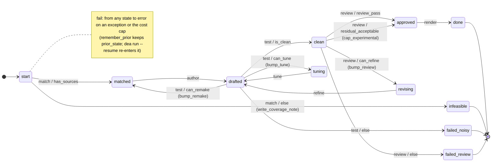

# Pipeline

The territory for the state machine in `src/detection_engineering_agent/pipeline.py`. [SPEC.md §5](SPEC.md) is the law; this page restates it from the code as it is today.

One `transitions` machine, one list of transitions, one four-line driver. No model output ever names a next state: every guard below is a function of code-computed gate results or of the findings list.

## State diagram

Generated from `pipeline.TRANSITIONS` by [`scripts/state_diagram.py`](scripts/state_diagram.py) (`uv run python docs/scripts/state_diagram.py`). One edge per entry; the label is `trigger / guard` plus the `after` callback in parentheses. Guards of one trigger are evaluated in the listed order and the first true one wins.



## States

| state | meaning | step run from it (`NEXT`) |
|---|---|---|
| `start` | idea and inventory loaded | `match` |
| `matched` | sources chosen | `author` |
| `drafted` | a draft SPL exists (from author, tune or refine) | `test` |
| `tuning` | gates failed, tune budget left | `tune` |
| `clean` | gates passed | `review` |
| `revising` | review found fixable findings | `refine` |
| `approved` | review passed, or residual findings acceptable | `render` |
| `done` | terminal: files written | exit 0 |
| `infeasible` | terminal: no sourcetype matched; `runs/<id>/coverage.md` written | exit 2 |
| `failed_noisy` | terminal: tune and remake budget spent, or tuning stalled | exit 3 |
| `failed_review` | terminal: review budget spent with a high or critical finding | exit 4 |
| `error` | terminal, resumable: exception or cost cap; `prior_state` holds where to resume | exit 1 |

`TERMINAL = {"done", "infeasible", "failed_noisy", "failed_review", "error"}`; `EXIT_CODES = {"done": 0, "error": 1, "infeasible": 2, "failed_noisy": 3, "failed_review": 4}`.

## Transitions and driver

Verbatim from `pipeline.py`:

```python
TRANSITIONS = [
    {"trigger": "match", "source": "start", "dest": "matched", "prepare": "do_match", "conditions": "has_sources"},
    {"trigger": "match", "source": "start", "dest": "infeasible", "after": "write_coverage_note"},
    {"trigger": "author", "source": "matched", "dest": "drafted", "prepare": "do_author"},
    {"trigger": "test", "source": "drafted", "dest": "clean", "prepare": "do_test", "conditions": "is_clean"},
    {"trigger": "test", "source": "drafted", "dest": "tuning", "conditions": "can_tune", "after": "bump_tune"},
    {"trigger": "test", "source": "drafted", "dest": "matched", "conditions": "can_remake", "after": "bump_remake"},
    {"trigger": "test", "source": "drafted", "dest": "failed_noisy"},
    {"trigger": "tune", "source": "tuning", "dest": "drafted", "prepare": "do_tune"},
    {"trigger": "review", "source": "clean", "dest": "approved", "prepare": "do_review", "conditions": "review_pass"},
    {"trigger": "review", "source": "clean", "dest": "revising", "conditions": "can_refine", "after": "bump_review"},
    {"trigger": "review", "source": "clean", "dest": "approved", "conditions": "residual_acceptable", "after": "cap_experimental"},
    {"trigger": "review", "source": "clean", "dest": "failed_review"},
    {"trigger": "refine", "source": "revising", "dest": "drafted", "prepare": "do_refine"},
    {"trigger": "render", "source": "approved", "dest": "done", "prepare": "do_render"},
    {"trigger": "fail", "source": "*", "dest": "error", "before": "remember_prior"},
]
NEXT = {"start": "match", "matched": "author", "drafted": "test", "tuning": "tune", "clean": "review",
        "revising": "refine", "approved": "render"}
```

`prepare` is attached only to the first transition of each trigger, so each step's work (`do_*`) runs exactly once per trigger, before any guard is read. If `prepare` raises, the state is unchanged and the driver routes to `error`.

```python
def drive(self) -> str:
    while self.state in NEXT:
        try:
            getattr(self, NEXT[self.state])()
        except Exception as e:  # includes CostCapExceeded, subprocess errors, Splunk errors
            self.error = repr(e)
            self.fail()
        self.save()
    return self.state
```

`save()` writes `runs/<idea_id>/state.json` after every trigger, so a run can be inspected while it is going (`cat runs/<id>/state.json`) and resumed after an error.

## Guards and callbacks

| name | definition in code |
|---|---|
| `has_sources` | `len(self.sources) > 0` |
| `is_clean` | `bool(self.gates["ok"])`: no lint errors, no Splunk errors, recall ok, a count, and `rate_per_day <= threshold` ([gates.md](gates.md)) |
| `can_tune` | `self.tunes < config.max_tunes` and the latest draft, after `spl.normalise()`, is not identical to any earlier draft (the stall rule) |
| `can_remake` | `self.remakes < config.max_remakes` |
| `review_pass` | no finding in the last round has a severity other than `low` |
| `can_refine` | `self.reviews < config.max_reviews` and the last round's `finding_key` differs from the round before it; `finding_key = sorted((category, severity))`, so rephrased `detail` text does not count as a new finding |
| `residual_acceptable` | no finding in the last round is `high` or `critical` |
| `bump_tune` | `tunes += 1` |
| `bump_remake` | `remakes += 1`, `tunes = 0`, and the abandoned line's last four drafts become `failed_attempts` entries `{"spl", "reason"}` for the next `author` call |
| `bump_review` | `reviews += 1` |
| `cap_experimental` | `status_cap = "experimental"` |
| `remember_prior` | `prior_state = state` |
| `write_coverage_note` | writes `runs/<id>/coverage.md`: the idea's wanted log sources and every inventory sourcetype name |

## Budgets and the call bound

Defaults in `pipeline.Config`: `max_tunes = 3` (`--tunes`), `max_remakes = 1` (`--remakes`), `max_reviews = 2` (`--reviews`), `max_cost_usd = 5.0` (`--max-cost`), `window = "-7d"`, `attack_index = "dea_attack"`, `out_dir = "detections"`, `max_scan_count = 50_000_000`.

With X = tunes, Y = remakes, Z = reviews the inference calls per run are bounded: authors `1 + Y` = 2, tunes `X * (Y + 1)` = 6 (`tunes` resets only in `bump_remake`), reviews `Z + 1` = 3, refines `Z` = 2, so **13 calls maximum** (plus at most one retry per call inside `llm.ask`). The happy path is **2 calls**: `author`, then a `review` that passes. Every cycle increments a bounded counter or is cut by a stall rule, so the machine terminates.

There is no `reset_tunes`: a refined draft that comes back noisy spends whatever tune budget is left on its line. A refined draft that fails lint takes the ordinary `drafted -> tuning` path (no Splunk run, one `tune` call with the lint line first in `problems`), and the review budget is untouched.

## Tune model ladder

`bump_tune` runs on the `drafted -> tuning` transition, so inside `do_tune` the counter reads 1, 2, 3 on rounds 1 to 3. On the last allowed round (`self.tunes == config.max_tunes`) `do_tune` calls the run's author model at effort `high` (`config.models["author"]` if `--model author=...` was given, else `prompts.MODEL["author"]`); the other rounds use `prompts.MODEL["tune"]` (`claude-sonnet-5-5`) unless `--model tune=...` overrides it.

## Terminal semantics

`done` is reached only through `approved`, and `approved` only through `clean`, so the rendered SPL is always the last draft that passed lint, run, recall and noise, and the review that approved it reviewed exactly that draft. The rendered `status` is `production` only when `status_cap is None` and `gates["recall"]["ran"]` is true, that is: the last review had only low findings, the idea had attack examples and every one of them hit, and no zero-hit run happened without a recall check. Everything else is `experimental`.

## Resume

`dea run --resume <idea>` loads `runs/<idea_id>/state.json` when it exists. The CLI's `Config` replaces the persisted one (so `--resume --max-cost 10` raises the cap); an `error` state is rewound to `prior_state`; counters, drafts, examples, cost and history survive. `do_match` rebuilds the example list from `idea.attack_examples` and `do_refine` skips events already ingested, so resuming inside those steps does not double-ingest.

## Run 5 as a trace

[`development/runs/e2e_run5_state.json`](development/runs/e2e_run5_state.json), the run behind every artifact in the README. Provenance: run 5 · 2026-11-05 · mock Splunk fixtures · real Claude inference · $1.30.

| # | ts (UTC) | step | model | cost |
|--:|---|---|---|--:|
| 1 | 04:27:26 | match | | |
| 2 | 04:27:39 | author | claude-opus-4-8 | $0.02 |
| 3 | 04:27:39 | test | | |
| 4 | 04:27:43 | tune | claude-sonnet-5-5 | $0.02 |
| 5 | 04:27:43 | test | | |
| 6 | 04:27:46 | tune | claude-sonnet-5-5 | $0.02 |
| 7 | 04:27:46 | test | | |
| 8 | 04:29:15 | review | claude-opus-4-8 | $0.22 |
| 9 | 04:30:23 | refine | claude-opus-4-8 | $0.19 |
| 10 | 04:30:23 | test | | |
| 11 | 04:32:20 | review | claude-opus-4-8 | $0.26 |
| 12 | 04:34:55 | refine | claude-opus-4-8 | $0.39 |
| 13 | 04:34:55 | test | | |
| 14 | 04:36:32 | review | claude-opus-4-8 | $0.20 |
| 15 | 04:36:32 | render | | |

States visited: `start -> matched -> drafted -> tuning -> drafted -> tuning -> drafted -> clean -> revising -> drafted -> clean -> revising -> drafted -> clean -> approved -> done`. Final counters: `tunes=2 remakes=0 reviews=2`, 8 inference calls of the 13 allowed, 9 minutes 6 seconds wall clock. The third review left one medium finding, so the run took the `residual_acceptable` edge and rendered with `status: experimental` (the fixture idea also has no `attack_examples`, which caps status to `experimental` on its own in `do_match`).
